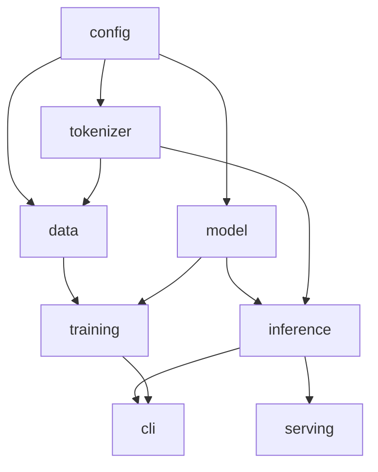

# Tiny GPT: Design Document

| Field | Value |
|---|---|
| Owner | Ahmad Bader |
| Implementer | Claude Code, following `CLAUDE.md` |
| Status | Approved for v1 |
| Repo | `tiny-gpt` (package `tinygpt`) |

## 1. Summary

Tiny GPT is a GPT 2 style decoder only transformer of about 5.8M parameters, implemented from scratch in PyTorch, trained on a CPU laptop in roughly 2 to 3 hours on a subset of the TinyStories dataset, and exposed through a small FastAPI service. A user sends a prompt such as "Once upon a time, a little fox" and receives a short story continuation. Weights are published to the Hugging Face Hub and the same FastAPI service runs as a Docker Space for a public demo.

The project grows directly out of `notebooks/01_tokenization_and_embeddings.ipynb` (tokenization, sliding window sampling, token and positional embeddings) and completes the rest of the pipeline: attention, transformer blocks, training, sampling, serving, packaging.

## 2. Goals and non goals

**Goals**

* G1. Given an English prompt, produce a grammatical and mostly coherent story continuation.
* G2. Full training run fits on Ahmad's laptop (22 logical cores, CPU) in about 3 hours or less.
* G3. Repository demonstrates engineering quality: clear module boundaries, typed code, meaningful tests, CI, Docker, reproducible config driven runs.
* G4. Every stage runs with one command and writes its artefacts to a predictable place.
* G5. Ahmad can explain every component and can rewrite the core components himself using the tests as an oracle.

**Non goals (v1)**

* Chat or instruction following, factual answers, safety tuning.
* Multi GPU or multi node training.
* Quantization, ONNX, distillation.
* A designed web UI. A single plain HTML page plus the auto generated `/docs` page is enough.
* Beating any benchmark. We compare only against simple baselines (section 8).

## 3. Key decisions

### D1. Dataset: TinyStories subset

* **Choice:** a subset of TinyStories (`roneneldan/TinyStories` on the Hugging Face Hub). Prefer the GPT 4 generated "V2" text files if present; verify exact file names on the dataset card at implementation time.
* **Why:** at about 6M parameters, a model trained on adult novels produces fluent sounding nonsense. TinyStories was created specifically so that models with only a few million parameters can learn coherent English with simple vocabulary and plot. This directly serves G1 within G2's compute budget.
* **Alternative kept behind config:** public domain children's stories and fairy tales from Project Gutenberg (`DataConfig.source = "gutenberg"`). Implement only the TinyStories path in v1; leave the Gutenberg loader as a clearly marked stretch item.
* **Licence:** read the licence from the dataset card, record it in `docs/DATA.md`, and repeat it in the model card. Do not guess.

### D2. Tokenizer: our own byte level BPE, vocab 4096

* **Choice:** train a byte level BPE tokenizer with vocab size 4096 using the Hugging Face `tokenizers` library on the training text. Special token: `<|endoftext|>` only.
* **Why not GPT 2's tokenizer (`tiktoken` gpt2, vocab 50257):** with `d_model = 256`, the GPT 2 vocab alone needs 50257 x 256 = 12.9M embedding parameters, more than double the rest of the model, and the output projection over 50257 logits dominates CPU compute per token. TinyStories uses a small vocabulary, so 4096 merges cover it well.
* **Link to the notebook:** byte level BPE has no `<|unk|>` token for the same reason the notebook shows with "Akwirw ier": any string decomposes into bytes.
* **Interface:** a `Tokenizer` protocol so `tiktoken` gpt2 can be plugged in as an alternative implementation (used in one comparison test and in `docs/LEARNING.md`).

### D3. Architecture: GPT 2 style, pre norm

| Setting | `small` (real run) | `tiny` (tests and CI) |
|---|---|---|
| `vocab_size` | 4096 | 512 |
| `context_length` | 256 | 64 |
| `d_model` | 256 | 64 |
| `n_layer` | 6 | 2 |
| `n_head` | 8 (head dim 32) | 2 |
| MLP hidden | 4 x `d_model`, GELU | same |
| `dropout` | 0.1 | 0.0 |
| Bias in linear layers | yes | yes |
| Weight tying | token embedding shared with output head | same |
| Parameters (approx.) | 5.8M | 0.14M |

* Learned absolute positional embeddings, as in the notebook.
* Pre norm blocks: `x = x + attn(ln1(x))`, `x = x + mlp(ln2(x))`, final LayerNorm before the head.
* Init: normal(0, 0.02) for linear and embedding weights, zeros for biases, residual output projections scaled by `1 / sqrt(2 * n_layer)`.
* Attention has two implementations selected by `ModelConfig.attention_impl`:
  * `"naive"`: explicit `QK^T / sqrt(d)`, causal mask, softmax, `@ V`. Written for clarity and learning.
  * `"sdpa"`: `torch.nn.functional.scaled_dot_product_attention(is_causal=True)`. Default for training speed.
  * A test asserts both give the same output within tolerance. This is the canonical "correctness reference plus optimised path" pattern.
* `GPT.num_parameters()` must match the analytic formula in a test.

### D4. Training

* Objective: next token cross entropy, exactly the `x` / `y` shift shown in the notebook.
* Optimiser: AdamW, betas (0.9, 0.95), weight decay 0.1 applied to parameters with `ndim >= 2` only.
* Learning rate: peak 1e-3, linear warmup 200 steps, cosine decay to 1e-4.
* Batch: 32 sequences x 256 tokens = 8192 tokens per step, with optional gradient accumulation in config.
* Gradient clipping at 1.0.
* Token budget: set from the benchmark (Phase 5) to fit about 2.5 hours. Planning estimate: about 4000 tokens per second, so about 35M to 40M tokens, about 4500 steps. Treat these numbers as estimates to be replaced by measured ones.
* Evaluate every 250 steps on a fixed number of validation batches. Save `last` and `best` (by validation loss) checkpoints. Support resuming from `last`.

### D5. Data format: uint16 memmap

* Tokenize all stories once, join with `<|endoftext|>`, write `data/processed/train.bin` and `val.bin` as `numpy.uint16` (valid because vocab < 65536), plus a `meta.json` with token counts and tokenizer hash.
* Training samples random windows of `context_length + 1` tokens from the memmap.
* **Why this instead of the notebook's `GPTDatasetV1`:** the notebook materialises every window as a Python list of tensors, which uses memory proportional to `num_windows x context_length`. A memmap uses about 2 bytes per token on disk and almost nothing in RAM, and random window sampling replaces the stride parameter. Keep a small `SlidingWindowDataset` equivalent to the notebook version for deterministic evaluation and tests.
* Tokenization in `prepare-data` uses multiprocessing across cores.

### D6. Sampling

* `generate(model, idx, max_new_tokens, temperature, top_k, seed, stop_token)` as a pure function.
* Temperature scaling then top k filtering then multinomial sampling. `temperature == 0` means greedy argmax.
* Stops at `<|endoftext|>` or `max_new_tokens`. Context is cropped to the last `context_length` tokens.
* No KV cache in v1 (Ahmad has implemented one before; it is a stretch item here).

### D7. Serving

* FastAPI app built by a `create_app(settings)` factory. The model and tokenizer load once in the lifespan handler into a `CompletionService`.
* Generation runs in a sync endpoint (FastAPI runs it in its threadpool) under `torch.inference_mode()`. A semaphore limits concurrent generations (default 2) so a small CPU host cannot be overloaded.
* Settings from environment variables via a small frozen dataclass (`TINYGPT_MODEL_DIR`, `TINYGPT_HF_REPO`, `TINYGPT_MAX_CONCURRENCY`, `TINYGPT_NUM_THREADS`).
* One static `index.html` (textarea, a few sliders, a button, plain JS `fetch`) served at `/`. No framework, no build step.

### D8. Publishing

* **Model:** Hugging Face Hub model repo containing `model.safetensors`, `config.json` (our `ModelConfig`), `tokenizer.json`, and `README.md` model card.
* **Demo:** Hugging Face Docker Space running the same FastAPI image. At startup it downloads the weights from the model repo with `huggingface_hub`. Docker Spaces expect the app on port 7860 by default (set `app_port` in the Space README front matter if different); confirm against current Spaces docs during Phase 8.
* **Code:** GitHub repo with CI badge, linking to both.

### D9. Tooling

`uv`, `ruff`, `mypy`, `pytest`, `pre-commit`, GitHub Actions, Docker. CPU only PyTorch wheels in CI and in the Docker image to keep them small and fast. Dependencies kept to: `torch`, `numpy`, `tokenizers`, `huggingface_hub`, `safetensors`, `fastapi`, `uvicorn`, `pydantic`, `matplotlib` (plots only), plus dev tools. `datasets` only if streaming the subset is clearly simpler than downloading raw text files; record the choice.

## 4. Repository layout

```text
tiny-gpt/
  CLAUDE.md
  DESIGN.md
  README.md
  LICENSE
  pyproject.toml
  uv.lock
  Makefile
  Dockerfile
  .pre-commit-config.yaml
  .github/workflows/ci.yml
  configs/
    tiny.toml
    small.toml
  notebooks/
    01_tokenization_and_embeddings.ipynb      # Ahmad's original notebook, unchanged
  docs/
    DECISIONS.md
    LEARNING.md
    LEARNING_PLAN.md
    DATA.md
    ENVIRONMENT.md
    RESULTS.md
    architecture.md                         # mermaid diagrams
  src/tinygpt/
    __init__.py
    config.py
    cli.py
    utils/
      seed.py
      device.py
      logging.py
    tokenizer/
      base.py            # Tokenizer protocol
      bpe.py             # HF tokenizers byte level BPE: train, save, load
      tiktoken_adapter.py
    data/
      download.py
      prepare.py         # text -> uint16 .bin + meta.json
      dataset.py         # MemmapTokenSampler, SlidingWindowDataset
    model/
      attention.py       # CausalSelfAttention (naive and sdpa)
      layers.py          # MLP, Block
      gpt.py             # GPT, init, num_parameters, save/load
    training/
      schedule.py        # warmup + cosine, pure function
      trainer.py         # Trainer: step, evaluate, fit, resume
      checkpoint.py      # safetensors + JSON state
      metrics.py         # CSV logger, loss plot
    inference/
      sampler.py         # generate()
      service.py         # CompletionService
    serving/
      app.py             # create_app factory, lifespan
      routes.py
      schemas.py         # pydantic request/response models
      settings.py
      static/index.html
    baselines.py         # unigram and bigram perplexity
  tests/
    conftest.py          # tiny tokenizer + tiny random model fixtures
    test_tokenizer.py
    test_dataset.py
    test_attention.py
    test_model.py
    test_schedule.py
    test_trainer.py
    test_sampler.py
    test_checkpoint.py
    test_api.py
    fixtures/sample_stories.txt   # a few KB of text, licence compatible
  data/        # gitignored
  runs/        # gitignored
  export/      # gitignored
```

## 5. Module design and dependency rules



Rules:

* Arrows point from dependency to dependent. No reverse imports. `serving` is the only package that imports FastAPI.
* `model` knows nothing about tokenizers or files except through `save_pretrained` / `from_pretrained`.
* `training.Trainer` receives the model, optimiser, samplers, and config through its constructor (dependency injection), so tests can pass the tiny model and fixture data.
* Pure functions where possible: `lr_at(step, cfg)`, `generate(...)`, `estimate_loss(...)`.

Key interfaces (signatures are a contract; names may be refined, behaviour may not):

```python
class Tokenizer(Protocol):
    @property
    def vocab_size(self) -> int: ...
    @property
    def eot_id(self) -> int: ...
    def encode(self, text: str) -> list[int]: ...
    def decode(self, ids: Sequence[int]) -> str: ...


class GPT(nn.Module):
    def __init__(self, cfg: ModelConfig) -> None: ...
    def forward(
        self, idx: Tensor, targets: Tensor | None = None
    ) -> tuple[Tensor, Tensor | None]: ...
    def num_parameters(self, exclude_embeddings: bool = False) -> int: ...
    def save_pretrained(self, out_dir: Path) -> None: ...
    @classmethod
    def from_pretrained(cls, model_dir: Path) -> "GPT": ...


def generate(model: GPT, idx: Tensor, cfg: SampleConfig, eot_id: int | None) -> Tensor: ...


class CompletionService:
    def __init__(self, model: GPT, tokenizer: Tokenizer, max_concurrency: int) -> None: ...
    def complete(self, req: CompletionRequest) -> CompletionResult: ...
```

## 6. Data pipeline

1. `tinygpt prepare-data` downloads or streams the TinyStories training text and takes the first N stories needed for about 1.2 x the token budget (default about 300k stories), plus about 5k stories from the official validation split. Raw subset saved to `data/raw/`. Avoid downloading the full corpus if streaming or partial reads are practical.
2. Light cleaning only: normalise whitespace, drop empty stories, strip non printable control characters. Log counts before and after.
3. `tinygpt train-tokenizer` trains the BPE on the training subset only (never on validation) and saves `data/tokenizer/tokenizer.json`.
4. Encode both splits in parallel, append `<|endoftext|>` after each story, write `train.bin`, `val.bin`, `meta.json` (story counts, token counts, average tokens per story, tokenizer SHA256).
5. Record dataset version, licence, subset size, and cleaning rules in `docs/DATA.md`.

## 7. Training run outputs

Each run writes to `runs/<YYYYmmdd_HHMM>_<config_name>/`:

* `config.toml` (fully resolved), `environment.json`, `git_commit.txt`
* `metrics.csv` (step, train loss, val loss, lr, tokens seen, tokens per second, elapsed)
* `loss.png` (train and val curves)
* `samples.md`: completions of the same 5 fixed prompts at every evaluation, so learning is visible over time
* `checkpoints/last/` and `checkpoints/best/` (safetensors weights, optimiser state, step, RNG state)
* `train.log`

## 8. Evaluation

* Validation loss and perplexity on the held out split.
* Two baselines computed by `baselines.py` on the same tokenization: unigram and bigram (add one smoothing) perplexity. The model must beat both clearly; this proves it learned more than token frequencies.
* Sanity check at step 0: loss should be close to `ln(vocab_size)` = `ln(4096)` = 8.32. A test asserts this on the tiny config with its own vocab.
* Qualitative: the five fixed prompts plus five unseen prompts, with fixed seeds, saved in `docs/RESULTS.md`.
* Performance: parameters, tokens trained, wall clock time, training tokens per second, generation latency for 100 tokens on the laptop and on the Space.

## 9. API

| Method | Path | Purpose |
|---|---|---|
| GET | `/` | Static demo page |
| GET | `/health` | Liveness: `{"status": "ok"}` |
| GET | `/v1/model` | Model metadata: parameters, config, training tokens, val perplexity, version |
| POST | `/v1/completions` | Generate a completion |
| GET | `/docs` | OpenAPI UI (FastAPI default) |

`POST /v1/completions` request:

```json
{
  "prompt": "Once upon a time, a little fox",
  "max_new_tokens": 120,
  "temperature": 0.8,
  "top_k": 40,
  "seed": 42
}
```

Validation (pydantic): `prompt` 1 to 500 characters; `max_new_tokens` 1 to 256; `temperature` 0.0 to 2.0; `top_k` 1 to `vocab_size` or null; `seed` optional integer.

Response:

```json
{
  "prompt": "Once upon a time, a little fox",
  "completion": " named Pip lived near the river ...",
  "tokens_generated": 87,
  "stop_reason": "eot",
  "latency_ms": 412
}
```

Errors: 422 for validation errors (FastAPI default), 503 while the model is still loading, 429 if the concurrency semaphore cannot be acquired within a short timeout.

## 10. Testing strategy

All tests run on CPU in under about 2 minutes using the `tiny` config and fixture text. Tests are written to be readable, because Ahmad will use them to check his own rewrites.

| Area | Test | What it proves |
|---|---|---|
| Tokenizer | round trip on ASCII, punctuation, unicode, emoji | lossless byte level encoding, no unknown token |
| Tokenizer | `<|endoftext|>` maps to `eot_id` and survives round trip | special token handling |
| Dataset | target window equals input window shifted by one | the core LM objective |
| Dataset | `SlidingWindowDataset` matches notebook behaviour for a given stride | continuity with the notebook |
| Attention | naive and sdpa outputs match (`atol` 1e-5) | the optimised path is correct |
| Attention | changing token at position t+1 does not change outputs at positions up to t | causal masking works |
| Model | logits shape `(B, T, vocab)` | wiring |
| Model | `num_parameters()` equals analytic formula | architecture is what the design says |
| Model | initial loss within 0.3 of `ln(vocab)` | sane initialisation |
| Model | output head weight is the same tensor as token embedding | weight tying |
| Schedule | warmup, peak, cosine end values | LR schedule correctness |
| Trainer | overfits one fixed batch to loss below 0.1 within 300 steps | gradients flow end to end |
| Trainer | resume from checkpoint continues with identical next loss | checkpoint completeness |
| Checkpoint | save then load gives identical logits | serialisation |
| Sampler | `temperature = 0` equals argmax decoding | sampling logic |
| Sampler | same seed gives same tokens; stops at `eot_id` | determinism, stopping |
| API | `/health`, valid completion, 422 on bad input, `/v1/model` fields | service contract |

## 11. Implementation phases

Each phase ends with its Definition of Done (DoD) green, a commit, a `docs/LEARNING.md` entry, and a pause for Ahmad (see CLAUDE.md section 4).

**Phase 0: Scaffold and environment.**
Repo skeleton, `pyproject.toml`, uv lock, Makefile, pre-commit, CI workflow, copy the notebook into `notebooks/`, environment probe to `docs/ENVIRONMENT.md`, `config.py` with `tiny.toml` and `small.toml`.
DoD: `make check` green in CI with a placeholder test. Learning focus: why `src/` layout and config dataclasses.

**Phase 1: Tokenizer.**
`Tokenizer` protocol, BPE training and loading, tiktoken adapter, tests.
DoD: tokenizer tests green; `tinygpt train-tokenizer` works on fixture text. Learning focus: how BPE merges are learned (notebook only used a pretrained one).

**Phase 2: Data pipeline.**
Download, clean, encode in parallel, memmap writer, samplers, `docs/DATA.md`.
DoD: dataset tests green; `make data` produces `train.bin`, `val.bin`, `meta.json` with sensible counts. Learning focus: memmap versus the notebook's list of tensors.

**Phase 3: Model.**
Attention (both paths), MLP, Block, GPT, init, weight tying, save and load.
DoD: attention and model tests green, including causality and initial loss. Learning focus: attention with every tensor shape written out; why pre norm; why tying.

**Phase 4: Training loop.**
Schedule, Trainer, checkpointing, metrics CSV and plot, fixed prompt samples, resume.
DoD: overfit and resume tests green; a 2 minute training run on the tiny config shows falling loss. Learning focus: the anatomy of one training step.

**Phase 5: Benchmark and real run.**
`tinygpt bench` sweeps thread counts (for example 6, 8, 12, 16, 22) and reports tokens per second and projected time for the token budget. Update `small.toml` with the measured best thread count and token budget, record in `docs/DECISIONS.md`, ask Ahmad for approval, launch the run in the background, monitor.
DoD: completed run, best checkpoint, loss curve, baselines computed, val perplexity clearly below the bigram baseline. Learning focus: reading loss curves, overfitting signs, compute budgeting.

**Phase 6: Sampling and CLI.**
`generate`, `CompletionService`, `tinygpt generate`.
DoD: sampler tests green; sensible completions for the fixed prompts in `docs/RESULTS.md`. Learning focus: temperature and top k, with side by side examples.

**Phase 7: API.**
Settings, app factory, routes, schemas, static page, API tests.
DoD: API tests green; `make serve` works locally and `/docs` is usable. Learning focus: app factory, lifespan, dependency boundaries.

**Phase 8: Packaging and publishing.**
`tinygpt export`, model card, Dockerfile (CPU torch, non root user, small base image), Hub upload script, Space README with front matter. Ask Ahmad for his HF token and approval before any upload.
DoD: Docker image runs locally; model repo and Space live; README links work. Learning focus: what a model card should honestly contain.

**Phase 9: Documentation and handover.**
README, `docs/architecture.md`, `docs/RESULTS.md`, resume bullet draft, `docs/LEARNING_PLAN.md`.
DoD: a stranger can clone, run `make setup && make test`, and download and run the published model with one command.

## 12. Learning plan specification (`docs/LEARNING_PLAN.md`)

Produce an ordered list of rewrite exercises. For each item include: the file and functions to delete, what to read first, the tests that must pass afterwards, an honest time estimate, and two "explain it back" questions. Required order:

1. **Data windows and memmap sampler** (`data/dataset.py`). Warm up from what he already knows in the notebook.
2. **BPE training algorithm in pure Python** (new file `tokenizer/my_bpe.py`, trained on the fixture text with a small vocab; tests: round trip, merges reduce sequence length, deterministic merges). The notebook only used a pretrained BPE; this is the gap.
3. **Causal self attention, naive path** (`model/attention.py`). Tests: equivalence with sdpa, causality.
4. **Block, MLP, GPT forward, init, weight tying** (`model/layers.py`, `model/gpt.py`). Tests: shapes, parameter formula, initial loss.
5. **One training step and the LR schedule** (`training/schedule.py`, `Trainer.train_step`). Tests: schedule values, overfit one batch.
6. **Sampler** (`inference/sampler.py`). Tests: greedy equals argmax, seed determinism, stop token.

Then a short section **"Understand, do not rewrite"** for FastAPI plumbing, Docker, CI, Hub upload, CLI, logging: one paragraph each on what it does and the interview question it answers.

Then a short **"Interview drill"** list: whiteboard attention shapes; why initial loss is `ln(V)`; why scale by `sqrt(d_head)`; pre norm versus post norm; why weight tying saves parameters; how a KV cache changes generation cost; how this training would change with data parallel training across machines.

## 13. README and resume

README sections in order: one line pitch, demo link and a short GIF or screenshot, sample completions, results table (parameters, tokens, training time, val perplexity versus baselines), architecture diagram, quickstart, project structure, design decisions link, testing and CI, limitations, licence and data credits.

Draft resume bullet, to be filled only with measured values:

> Built a [N]M parameter GPT from scratch in PyTorch (custom byte level BPE, causal attention, training loop), trained on CPU on [X]M TinyStories tokens in [Y] hours, reaching validation perplexity [Z] versus [B] for a bigram baseline; served via a typed FastAPI service in Docker on Hugging Face Spaces with [T] tests and GitHub Actions CI.

## 14. Risks and mitigations

| Risk | Mitigation |
|---|---|
| CPU throughput lower than planned | Benchmark first; reduce `context_length` to 128 or `n_layer` to 4 before reducing data; record in DECISIONS |
| Hybrid CPU cores make 22 threads slower | Thread sweep in `bench` |
| WSL disk IO slow | Keep repo and data on the Linux filesystem |
| DataLoader worker issues | Memmap sampler needs no worker processes; keep `num_workers = 0` |
| Overfitting a small subset | Monitor val loss; keep best checkpoint; dropout 0.1 |
| Free Space sleeps when idle | State cold start in README; keep image small so restart is quick |
| Dataset licence misunderstood | Read the card, record it, credit it in README and model card |
| Scope creep | Section 2 non goals and section 15; anything new goes through DECISIONS.md |

## 15. After v1 (only once v1 is published)

* KV cache in the sampler with a latency comparison.
* Streaming completions with server sent events.
* Data parallel training on CPU with `torch.distributed` (gloo backend, two or more processes) as a first step towards distributed training work.
* bf16 autocast on CPU and its effect on throughput.
* Gutenberg children's stories as a second dataset, compared on the same prompts.
