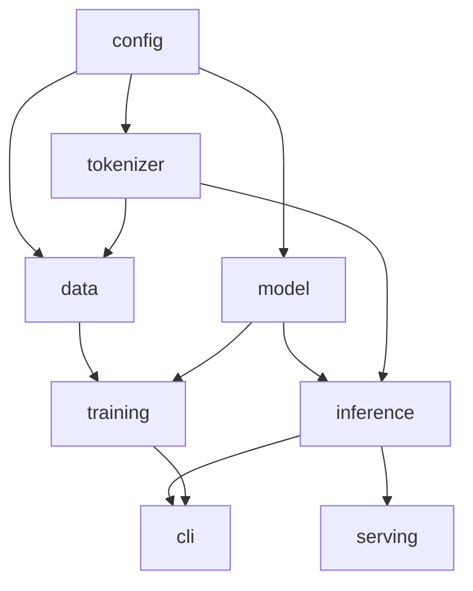

# Tiny GPT: Design Document

| Field | Value |
|---|---|
| Owner | Ahmad Bader |
| Implementer | Claude Code, following `CLAUDE.md` |
| Status | Approved for v1 |
| Repo | `tiny-gpt` (package `tinygpt`) |

## 1. Summary

Tiny GPT is a GPT-2 style decoder-only transformer of about 5.8M parameters. It is implemented from scratch in PyTorch, trained on a CPU laptop in roughly 2 to 3 hours on a subset of the TinyStories dataset, and exposed through a small FastAPI service. A client sends a prompt such as "Once upon a time, a little fox" and receives a short story continuation. Weights are published to the Hugging Face Hub, and the same service runs as a Docker Space for a public demo.

The project extends `notebooks/01_tokenization_and_embeddings.ipynb` (tokenization, sliding-window sampling, token and positional embeddings) and completes the pipeline: attention, transformer blocks, training, sampling, serving and packaging.

## 2. Goals and non-goals

**Goals**

* G1. Produce a grammatical and mostly coherent story continuation from an English prompt.
* G2. Complete the full training run on the owner's laptop (22 logical cores, CPU) in about 3 hours or less.
* G3. Demonstrate engineering quality: clear module boundaries, typed code, meaningful tests, CI, Docker and reproducible, config-driven runs.
* G4. Run every stage with one command and write its artefacts to a predictable location.
* G5. Enable the owner to explain every component and to rewrite the core components independently, using the tests as an oracle.

**Non-goals (v1)**

* Chat or instruction following, factual answers, safety tuning.
* Multi-GPU or multi-node training.
* Quantization, ONNX, distillation.
* A designed web UI. A single plain HTML page plus the generated `/docs` page is sufficient.
* Benchmark performance. The model is compared only against simple baselines (section 8).

## 3. Key decisions

### D1. Dataset: TinyStories subset

* **Choice:** a subset of TinyStories (`roneneldan/TinyStories` on the Hugging Face Hub), preferring the GPT-4 generated "V2" text files. Exact file names are verified on the dataset card at implementation time.
* **Rationale:** at about 6M parameters, a model trained on adult novels produces fluent but meaningless text. TinyStories was created so that models with a few million parameters can learn coherent English with simple vocabulary and plot. This serves G1 within the G2 compute budget.
* **Alternative (behind config):** public-domain children's stories from Project Gutenberg (`DataConfig.source = "gutenberg"`). Only the TinyStories path is implemented in v1; the Gutenberg loader is a marked stretch item.
* **Licence:** read from the dataset card, recorded in `docs/DATA.md` and repeated in the model card.

### D2. Tokenizer: custom byte-level BPE, vocabulary 4096

* **Choice:** a byte-level BPE tokenizer with vocabulary size 4096, trained with the Hugging Face `tokenizers` library on the training text. The only special token is `<|endoftext|>`.
* **Rationale for not using the GPT-2 tokenizer (`tiktoken` gpt2, vocabulary 50257):** with `d_model = 256`, the GPT-2 vocabulary alone requires 50257 × 256 = 12.9M embedding parameters, more than double the rest of the model, and the 50257-way output projection would dominate CPU compute per token. TinyStories uses a small vocabulary that 4096 merges cover well.
* **Link to the notebook:** byte-level BPE has no `<|unk|>` token, because any string decomposes into bytes (the notebook's "Akwirw ier" example).
* **Interface:** a `Tokenizer` protocol, so the `tiktoken` gpt2 tokenizer can be substituted (used in one comparison test and in `docs/LEARNING.md`).

### D3. Architecture: GPT-2 style, pre-norm

| Setting | `small` (real run) | `tiny` (tests and CI) |
|---|---|---|
| `vocab_size` | 4096 | 512 |
| `context_length` | 256 | 64 |
| `d_model` | 256 | 64 |
| `n_layer` | 6 | 2 |
| `n_head` | 8 (head dim 32) | 2 |
| MLP hidden | 4 × `d_model`, GELU | same |
| `dropout` | 0.1 | 0.0 |
| Bias in linear layers | yes | yes |
| Weight tying | token embedding shared with output head | same |
| Parameters (approx.) | 5.8M | 0.14M |

* Learned absolute positional embeddings, as in the notebook.
* Pre-norm blocks: `x = x + attn(ln1(x))`, `x = x + mlp(ln2(x))`, with a final LayerNorm before the head.
* Initialisation: normal(0, 0.02) for linear and embedding weights, zeros for biases, and residual output projections scaled by `1 / sqrt(2 * n_layer)`.
* Attention has two implementations selected by `ModelConfig.attention_impl`:
  * `"naive"`: explicit `QK^T / sqrt(d)`, causal mask, softmax, `@ V`. Written for clarity.
  * `"sdpa"`: `torch.nn.functional.scaled_dot_product_attention(is_causal=True)`. The default, for training speed.
  * A test asserts that both produce the same output within tolerance (a readable reference plus an optimised path).
* `GPT.num_parameters()` must match the analytic formula in a test.

### D4. Training

* Objective: next-token cross entropy, using the `x` / `y` shift shown in the notebook.
* Optimiser: AdamW, betas (0.9, 0.95), weight decay 0.1 applied only to parameters with `ndim >= 2`.
* Learning rate: peak 1e-3, linear warmup over 200 steps, cosine decay to 1e-4.
* Batch: 32 sequences × 256 tokens = 8192 tokens per step, with optional gradient accumulation in config.
* Gradient clipping at 1.0.
* Token budget: set from the Phase 5 benchmark to fit about 2.5 hours. The planning estimate was about 4000 tokens per second, giving 35M to 40M tokens and about 4500 steps. These figures are estimates to be replaced by measured values.
* Evaluation every 250 steps on a fixed number of validation batches. `last` and `best` (by validation loss) checkpoints are saved, and training can resume from `last`.

### D5. Data format: uint16 memmap

* All stories are tokenized once, joined with `<|endoftext|>`, and written to `data/processed/train.bin` and `val.bin` as `numpy.uint16` (valid because the vocabulary is below 65536), together with a `meta.json` containing token counts and the tokenizer hash.
* Training samples random windows of `context_length + 1` tokens from the memmap.
* **Rationale versus the notebook's `GPTDatasetV1`:** the notebook materialises every window as a Python list of tensors, so memory grows with `num_windows × context_length`. A memmap needs about 2 bytes per token on disk and almost no RAM, and random window sampling replaces the stride parameter. A small `SlidingWindowDataset` equivalent to the notebook version is retained for deterministic evaluation and tests.
* `prepare-data` tokenizes in parallel across cores.

### D6. Sampling

* `generate(model, idx, max_new_tokens, temperature, top_k, seed, stop_token)` is a pure function.
* The pipeline is temperature scaling, then top-k filtering, then multinomial sampling. `temperature == 0` selects greedy argmax.
* Generation stops at `<|endoftext|>` or `max_new_tokens`. The context is cropped to the last `context_length` tokens.
* There is no KV cache in v1; it is a stretch item.

### D7. Serving

* The FastAPI app is built by a `create_app(settings)` factory. The model and tokenizer load once in the lifespan handler into a `CompletionService`.
* Generation runs in a synchronous endpoint (executed by FastAPI in its threadpool) under `torch.inference_mode()`. A semaphore limits concurrent generations (default 2) so that a small CPU host is not overloaded.
* Settings come from environment variables through a small frozen dataclass (`TINYGPT_MODEL_DIR`, `TINYGPT_HF_REPO`, `TINYGPT_MAX_CONCURRENCY`, `TINYGPT_NUM_THREADS`).
* A single static `index.html` (textarea, a few sliders, a button and plain JS `fetch`) is served at `/`, with no framework or build step.

### D8. Publishing

* **Model:** a Hugging Face Hub model repository containing `model.safetensors`, `config.json` (the `ModelConfig`), `tokenizer.json` and a `README.md` model card.
* **Demo:** a Hugging Face Docker Space running the same FastAPI image. At startup it downloads the weights from the model repository with `huggingface_hub`. Docker Spaces expect the app on port 7860 by default (`app_port` in the Space README front matter if different); this is confirmed against current Spaces documentation during Phase 8.
* **Code:** a GitHub repository with a CI badge, linking to both.

### D9. Tooling

`uv`, `ruff`, `mypy`, `pytest`, `pre-commit`, GitHub Actions and Docker. CPU-only PyTorch wheels are used in CI and in the Docker image to keep them small and fast. Dependencies are limited to `torch`, `numpy`, `tokenizers`, `huggingface_hub`, `safetensors`, `fastapi`, `uvicorn`, `pydantic`, `matplotlib` (plots only) and dev tools. `datasets` is added only if streaming the subset is clearly simpler than downloading raw text files, and the choice is recorded.

## 4. Repository layout

```text
tiny-gpt/
  CLAUDE.md
  DESIGN.md
  README.md
  LICENSE
  pyproject.toml
  uv.lock
  Makefile
  Dockerfile
  .pre-commit-config.yaml
  .github/workflows/ci.yml
  configs/
    tiny.toml
    small.toml
  notebooks/
    01_tokenization_and_embeddings.ipynb      # original notebook, unchanged
  docs/
    DECISIONS.md
    LEARNING.md
    LEARNING_PLAN.md
    DATA.md
    ENVIRONMENT.md
    RESULTS.md
    architecture.md                         # mermaid diagrams
  src/tinygpt/
    __init__.py
    config.py
    cli.py
    utils/
      seed.py
      device.py
      logging.py
    tokenizer/
      base.py            # Tokenizer protocol
      bpe.py             # HF tokenizers byte-level BPE: train, save, load
      tiktoken_adapter.py
    data/
      download.py
      prepare.py         # text -> uint16 .bin + meta.json
      dataset.py         # MemmapTokenSampler, SlidingWindowDataset
    model/
      attention.py       # CausalSelfAttention (naive and sdpa)
      layers.py          # MLP, Block
      gpt.py             # GPT, init, num_parameters, save/load
    training/
      schedule.py        # warmup + cosine, pure function
      trainer.py         # Trainer: step, evaluate, fit, resume
      checkpoint.py      # safetensors + JSON state
      metrics.py         # CSV logger, loss plot
    inference/
      sampler.py         # generate()
      service.py         # CompletionService
    serving/
      app.py             # create_app factory, lifespan
      routes.py
      schemas.py         # pydantic request/response models
      settings.py
      static/index.html
    baselines.py         # unigram and bigram perplexity
  tests/
    conftest.py          # tiny tokenizer + tiny random model fixtures
    test_tokenizer.py
    test_dataset.py
    test_attention.py
    test_model.py
    test_schedule.py
    test_trainer.py
    test_sampler.py
    test_checkpoint.py
    test_api.py
    fixtures/sample_stories.txt   # a few KB of text, licence compatible
  data/        # gitignored
  runs/        # gitignored
  export/      # gitignored
```

## 5. Module design and dependency rules



Rules:

* Arrows point from dependency to dependent, and reverse imports are not permitted. `serving` is the only package that imports FastAPI.
* `model` has no knowledge of tokenizers or files except through `save_pretrained` / `from_pretrained`.
* `training.Trainer` receives the model, optimiser, samplers and config through its constructor (dependency injection), so tests can supply the tiny model and fixture data.
* Pure functions are preferred: `lr_at(step, cfg)`, `generate(...)`, `estimate_loss(...)`.

Key interfaces (signatures are a contract; names may be refined, behaviour may not):

```python
class Tokenizer(Protocol):
    @property
    def vocab_size(self) -> int: ...
    @property
    def eot_id(self) -> int: ...
    def encode(self, text: str) -> list[int]: ...
    def decode(self, ids: Sequence[int]) -> str: ...


class GPT(nn.Module):
    def __init__(self, cfg: ModelConfig) -> None: ...
    def forward(
        self, idx: Tensor, targets: Tensor | None = None
    ) -> tuple[Tensor, Tensor | None]: ...
    def num_parameters(self, exclude_embeddings: bool = False) -> int: ...
    def save_pretrained(self, out_dir: Path) -> None: ...
    @classmethod
    def from_pretrained(cls, model_dir: Path) -> "GPT": ...


def generate(model: GPT, idx: Tensor, cfg: SampleConfig, eot_id: int | None) -> Tensor: ...


class CompletionService:
    def __init__(self, model: GPT, tokenizer: Tokenizer, max_concurrency: int) -> None: ...
    def complete(self, req: CompletionRequest) -> CompletionResult: ...
```

## 6. Data pipeline

1. `tinygpt prepare-data` downloads or streams the TinyStories training text and takes the first N stories needed for about 1.2 × the token budget (default about 300k stories), plus about 5k stories from the official validation split. The raw subset is saved to `data/raw/`. Downloading the full corpus is avoided where streaming or partial reads are practical.
2. Light cleaning only: whitespace normalisation, removal of empty stories, and removal of non-printable control characters. Counts before and after are logged.
3. `tinygpt train-tokenizer` trains the BPE on the training subset only (never on validation) and saves `data/tokenizer/tokenizer.json`.
4. Both splits are encoded in parallel with `<|endoftext|>` appended after each story, and `train.bin`, `val.bin` and `meta.json` are written (story counts, token counts, average tokens per story, tokenizer SHA256).
5. Dataset version, licence, subset size and cleaning rules are recorded in `docs/DATA.md`.

## 7. Training run outputs

Each run writes to `runs/<YYYYmmdd_HHMM>_<config_name>/`:

* `config.toml` (fully resolved), `environment.json`, `git_commit.txt`
* `metrics.csv` (step, train loss, val loss, lr, tokens seen, tokens per second, elapsed)
* `loss.png` (train and validation curves)
* `samples.md`: completions of the same 5 fixed prompts at every evaluation, making learning progress visible
* `checkpoints/last/` and `checkpoints/best/` (safetensors weights, optimiser state, step, RNG state)
* `train.log`

## 8. Evaluation

* Validation loss and perplexity on the held-out split.
* Two baselines, computed by `baselines.py` on the same tokenization: unigram and bigram (add-one smoothing) perplexity. The model must beat both clearly, which shows it learned more than token frequencies.
* Sanity check at step 0: loss should be close to `ln(vocab_size)` = `ln(4096)` = 8.32. A test asserts this on the tiny config with its own vocabulary.
* Qualitative: five fixed prompts plus five unseen prompts, with fixed seeds, recorded in `docs/RESULTS.md`.
* Performance: parameters, tokens trained, wall-clock time, training tokens per second, and generation latency for 100 tokens on the laptop and on the Space.

## 9. API

| Method | Path | Purpose |
|---|---|---|
| GET | `/` | Static demo page |
| GET | `/health` | Liveness: `{"status": "ok"}` |
| GET | `/v1/model` | Model metadata: parameters, config, training tokens, validation perplexity, version |
| POST | `/v1/completions` | Generate a completion |
| GET | `/docs` | OpenAPI UI (FastAPI default) |

`POST /v1/completions` request:

```json
{
  "prompt": "Once upon a time, a little fox",
  "max_new_tokens": 120,
  "temperature": 0.8,
  "top_k": 40,
  "seed": 42
}
```

Validation (pydantic): `prompt` 1 to 500 characters; `max_new_tokens` 1 to 256; `temperature` 0.0 to 2.0; `top_k` 1 to `vocab_size` or null; `seed` an optional integer.

Response:

```json
{
  "prompt": "Once upon a time, a little fox",
  "completion": " named Pip lived near the river ...",
  "tokens_generated": 87,
  "stop_reason": "eot",
  "latency_ms": 412
}
```

Errors: 422 for validation errors (FastAPI default), 503 while the model is loading, and 429 if the concurrency semaphore cannot be acquired within a short timeout.

## 10. Testing strategy

All tests run on CPU in under about 2 minutes using the `tiny` config and fixture text. Tests are written to be readable, because they also serve as the oracle for the owner's rewrites.

| Area | Test | What it proves |
|---|---|---|
| Tokenizer | round trip on ASCII, punctuation, unicode, emoji | lossless byte-level encoding, no unknown token |
| Tokenizer | `<|endoftext|>` maps to `eot_id` and survives round trip | special-token handling |
| Dataset | target window equals input window shifted by one | the core language-modelling objective |
| Dataset | `SlidingWindowDataset` matches notebook behaviour for a given stride | continuity with the notebook |
| Attention | naive and sdpa outputs match (`atol` 1e-5) | the optimised path is correct |
| Attention | changing the token at position t+1 does not change outputs at positions up to t | causal masking works |
| Model | logits shape `(B, T, vocab)` | wiring |
| Model | `num_parameters()` equals analytic formula | architecture matches the design |
| Model | initial loss within 0.3 of `ln(vocab)` | sound initialisation |
| Model | output head weight is the same tensor as token embedding | weight tying |
| Schedule | warmup, peak and cosine end values | LR schedule correctness |
| Trainer | overfits one fixed batch to loss below 0.1 within 300 steps | gradients flow end to end |
| Trainer | resume from checkpoint continues with identical next loss | checkpoint completeness |
| Checkpoint | save then load gives identical logits | serialisation |
| Sampler | `temperature = 0` equals argmax decoding | sampling logic |
| Sampler | same seed gives same tokens; stops at `eot_id` | determinism, stopping |
| API | `/health`, valid completion, 422 on bad input, `/v1/model` fields | service contract |

## 11. Implementation phases

Each phase ends with its Definition of Done (DoD) met, a commit, a `docs/LEARNING.md` entry and a pause for the owner (see `CLAUDE.md` section 4).

**Phase 0: Scaffold and environment.**
Repository skeleton, `pyproject.toml`, uv lock, Makefile, pre-commit, CI workflow, the notebook copied into `notebooks/`, an environment probe written to `docs/ENVIRONMENT.md`, and `config.py` with `tiny.toml` and `small.toml`.
DoD: `make check` passes in CI with a placeholder test. Learning focus: the `src/` layout and config dataclasses.

**Phase 1: Tokenizer.**
`Tokenizer` protocol, BPE training and loading, tiktoken adapter, tests.
DoD: tokenizer tests pass; `tinygpt train-tokenizer` works on fixture text. Learning focus: how BPE merges are learned (the notebook used only a pretrained tokenizer).

**Phase 2: Data pipeline.**
Download, clean, parallel encoding, memmap writer, samplers and `docs/DATA.md`.
DoD: dataset tests pass; `make data` produces `train.bin`, `val.bin` and `meta.json` with sensible counts. Learning focus: memmap versus the notebook's list of tensors.

**Phase 3: Model.**
Attention (both paths), MLP, Block, GPT, initialisation, weight tying, save and load.
DoD: attention and model tests pass, including causality and initial loss. Learning focus: attention with every tensor shape written out; why pre-norm; why weight tying.

**Phase 4: Training loop.**
Schedule, Trainer, checkpointing, metrics CSV and plot, fixed-prompt samples and resume.
DoD: overfit and resume tests pass; a 2-minute training run on the tiny config shows falling loss. Learning focus: the anatomy of one training step.

**Phase 5: Benchmark and real run.**
`tinygpt bench` sweeps thread counts (for example 6, 8, 12, 16, 22) and reports tokens per second and projected time for the token budget. `small.toml` is updated with the measured best thread count and token budget, the decision is recorded in `docs/DECISIONS.md`, the owner's approval is requested, and the run is launched in the background and monitored.
DoD: completed run, best checkpoint, loss curve, baselines computed, and validation perplexity clearly below the bigram baseline. Learning focus: reading loss curves, signs of overfitting, compute budgeting.

**Phase 6: Sampling and CLI.**
`generate`, `CompletionService` and `tinygpt generate`.
DoD: sampler tests pass; sensible completions for the fixed prompts in `docs/RESULTS.md`. Learning focus: temperature and top-k, with side-by-side examples.

**Phase 7: API.**
Settings, app factory, routes, schemas, static page and API tests.
DoD: API tests pass; `make serve` works locally and `/docs` is usable. Learning focus: app factory, lifespan and dependency boundaries.

**Phase 8: Packaging and publishing.**
`tinygpt export`, model card, Dockerfile (CPU torch, non-root user, small base image), Hub upload script and Space README with front matter. The owner's Hugging Face token and approval are required before any upload.
DoD: Docker image runs locally; model repository and Space are live; README links work. Learning focus: what a model card should honestly contain.

**Phase 9: Documentation and handover.**
README, `docs/architecture.md`, `docs/RESULTS.md`, resume bullet draft and `docs/LEARNING_PLAN.md`.
DoD: a new reader can clone the repository, run `make setup && make test`, and download and run the published model with one command.

## 12. Learning plan specification (`docs/LEARNING_PLAN.md`)

An ordered list of rewrite exercises. Each item specifies the file and functions to delete, what to read first, the tests that must pass afterwards, an honest time estimate, and two "explain it back" questions. Required order:

1. **Data windows and memmap sampler** (`data/dataset.py`), building on the notebook.
2. **BPE training algorithm in pure Python** (new file `tokenizer/my_bpe.py`, trained on the fixture text with a small vocabulary; tests: round trip, merges reduce sequence length, deterministic merges). The notebook used only a pretrained BPE; this closes that gap.
3. **Causal self-attention, naive path** (`model/attention.py`). Tests: equivalence with sdpa, causality.
4. **Block, MLP, GPT forward, initialisation, weight tying** (`model/layers.py`, `model/gpt.py`). Tests: shapes, parameter formula, initial loss.
5. **One training step and the LR schedule** (`training/schedule.py`, `Trainer.train_step`). Tests: schedule values, overfit one batch.
6. **Sampler** (`inference/sampler.py`). Tests: greedy equals argmax, seed determinism, stop token.

A short section, **"Understand, do not rewrite"**, covers FastAPI plumbing, Docker, CI, Hub upload, CLI and logging: one paragraph each on what it does and the interview question it answers.

A short **"Interview drill"** list follows: whiteboard attention shapes; why initial loss is `ln(V)`; why scale by `sqrt(d_head)`; pre-norm versus post-norm; why weight tying saves parameters; how a KV cache changes generation cost; how this training would change under data-parallel training across machines.

## 13. README and resume

README sections, in order: one-line pitch, demo link with a short GIF or screenshot, sample completions, results table (parameters, tokens, training time, validation perplexity versus baselines), architecture diagram, quickstart, project structure, design decisions link, testing and CI, limitations, licence and data credits.

Draft resume bullet, filled only with measured values:

> Built a [N]M parameter GPT from scratch in PyTorch (custom byte level BPE, causal attention, training loop), trained on CPU on [X]M TinyStories tokens in [Y] hours, reaching validation perplexity [Z] versus [B] for a bigram baseline; served via a typed FastAPI service in Docker on Hugging Face Spaces with [T] tests and GitHub Actions CI.

## 14. Risks and mitigations

| Risk | Mitigation |
|---|---|
| CPU throughput lower than planned | Benchmark first; reduce `context_length` to 128 or `n_layer` to 4 before reducing data; record in DECISIONS |
| Hybrid CPU cores make 22 threads slower | Thread sweep in `bench` |
| Slow WSL disk IO | Keep the repository and data on the Linux filesystem |
| DataLoader worker issues | The memmap sampler needs no worker processes; keep `num_workers = 0` |
| Overfitting a small subset | Monitor validation loss; keep the best checkpoint; dropout 0.1 |
| Free Space sleeps when idle | State the cold start in the README; keep the image small so restart is quick |
| Dataset licence misunderstood | Read the card, record it, credit it in the README and model card |
| Scope creep | Section 2 non-goals and section 15; any addition goes through DECISIONS.md |

## 15. After v1 (only once v1 is published)

* KV cache in the sampler, with a latency comparison.
* Streaming completions with server-sent events.
* Data-parallel training on CPU with `torch.distributed` (gloo backend, two or more processes) as a first step towards distributed training.
* bf16 autocast on CPU and its effect on throughput.
* Gutenberg children's stories as a second dataset, compared on the same prompts.
