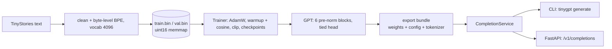

# Tiny GPT

A 5.8M-parameter GPT written from scratch in PyTorch, trained on a laptop CPU in about 8 hours, that continues children's stories.
Its validation perplexity is **5.4, against 38.4 for a bigram baseline**.

[](https://github.com/Ahmadbader17/tinygpt/actions/workflows/ci.yml)

- **Model on the Hugging Face Hub:** https://huggingface.co/Ahmadbader17/tiny-gpt (weights, tokenizer, model card)
- **Hosted demo:** none. Free Hugging Face Spaces no longer run Docker apps, so the demo ships as a Docker image you run yourself (see Quickstart).

## Sample completions
Temperature 0.8, top-k 40, fixed seeds. The first generation for each prompt, not cherry-picked
(more in [`docs/RESULTS.md`](docs/RESULTS.md), including failures).

> **One day, a little girl named** Lucy went to play outside. She saw a big tree with a pretty flower. She thought it would be fun to draw with it.
> So, she put the flower on the tree and started to draw a pretty picture. She was very proud of her drawing.

> **A tiny dragon lived in** a big, green forest. The dragon had many friends, like birds, monkeys, and squirrels. They all played together in the forest all day.
> One day, a mean wolf came to the forest. He wanted to destroy the forest. The wolf saw the little bird and wanted to help. *(the plot loses its thread here)*

## Results
| Model | Validation loss | Perplexity |
|---|---|---|
| Uniform guess | 8.32 | 4096 |
| Unigram counts | 5.88 | 357 |
| Bigram counts | 3.65 | 38.4 |
| **Tiny GPT** | **1.688** | **5.41** |

| | |
|---|---|
| Parameters | 5,853,184 (6 layers, d_model 256, 8 heads, context 256, tied embeddings) |
| Training data | 77.8M tokens: 1.28 passes over 60.8M tokens of TinyStories (V2, GPT-4 generated) |
| Training time | 7.9 hours of running time on one Intel Core Ultra 9 185H laptop CPU (12 threads, no GPU) |
| Generation | about 0.5 s for 100 tokens on that CPU, no KV cache |
| Tests | 120 |

Perplexity is per token of this 4096-token tokenizer on TinyStories, so it is only comparable to the baselines above, not to other models.


## Architecture

Details in [`docs/architecture.md`](docs/architecture.md).

## Quickstart
**Run the published model with one command** (downloads 24 MB from the Hub):
```bash
git clone https://github.com/Ahmadbader17/tinygpt && cd tinygpt && uv sync
uv run tinygpt generate --hub Ahmadbader17/tiny-gpt --prompt "Once upon a time, a little fox" --seed 42
```
**Run the API in Docker** (the image is about 1.7 GB; the model downloads at startup):
```bash
docker build -t tiny-gpt .
docker run -p 7860:7860 -e TINYGPT_HF_REPO=Ahmadbader17/tiny-gpt tiny-gpt
# then open http://localhost:7860  (demo page)  or  http://localhost:7860/docs  (API)
curl -X POST localhost:7860/v1/completions -H 'content-type: application/json' \
  -d '{"prompt": "Once upon a time, a little fox", "max_new_tokens": 60, "seed": 42}'
```
**Develop and reproduce training** (needs [uv](https://docs.astral.sh/uv/)):
```bash
make setup && make test      # environment, then 120 tests (about 10 s, CPU only)
make data                    # download 300k stories, train the tokenizer, write train.bin / val.bin (about 1 min)
uv run tinygpt bench --config configs/small.toml        # measure tokens/s per thread count on your machine
uv run tinygpt train --config configs/small.toml --max-steps 9500 --run-dir runs/mine
uv run tinygpt generate --run runs/mine --prompt "Once upon a time"
```
Training takes hours on a CPU. Re-run the same command with `--resume` to continue after an interruption.

## Project structure
```text
src/tinygpt/
  tokenizer/   byte-level BPE (train, save, load) and a tiktoken comparison adapter
  data/        download, clean, encode to uint16 memmap, random-window sampler
  model/       causal attention (naive + sdpa), MLP, pre-norm block, GPT, save/load
  training/    LR schedule, Trainer, atomic checkpoints, metrics + loss plot, benchmark
  inference/   generate() (temperature, top-k, seed, stop token), CompletionService, export bundle
  serving/     FastAPI app factory, routes, schemas, settings, static demo page
  baselines.py unigram and bigram perplexity
tests/         120 tests; configs/ tiny (CI) and small (real run); docs/ design, decisions, results
```

## Design decisions
[`DESIGN.md`](DESIGN.md) is the spec; [`docs/DECISIONS.md`](docs/DECISIONS.md) records every change made along the way with its reason
(for example, why 12 threads and not 22, why one epoch plus a repeat pass, and what is still unverified).
[`docs/LEARNING.md`](docs/LEARNING.md) explains each stage with tensor shapes.

## Testing and CI
`make check` runs ruff, ruff format, mypy and pytest, and GitHub Actions runs the same on every push. Tests are written to be read:
they check that the readable and fused attention paths agree (1e-5), that future tokens never change earlier outputs, that the parameter count equals a hand-derived formula,
that the untrained loss is ln(vocab), and that a resumed training run reproduces the next five losses exactly.

## Limitations
- It is a story generator, not an assistant: it cannot follow instructions or answer questions, and it only knows simple TinyStories-style English.
- Output is fluent at sentence level but repeats itself, loses objects and plot threads, and sometimes contradicts itself.
- The training stories were written by an LLM, so the model inherits that LLM's biases. It has not been evaluated for bias or safety.
- No KV cache, so generation cost per token grows with the prompt. The context is 256 tokens.
- I did not host a live demo (see above).

## Licence and credits
Code and weights: MIT (see `LICENSE`). Training data: [TinyStories](https://huggingface.co/datasets/roneneldan/TinyStories) by Ronen Eldan and Yuanzhi Li,
CDLA-Sharing-1.0 per the dataset card. Check the dataset card for current terms before reusing the data or weights commercially.
