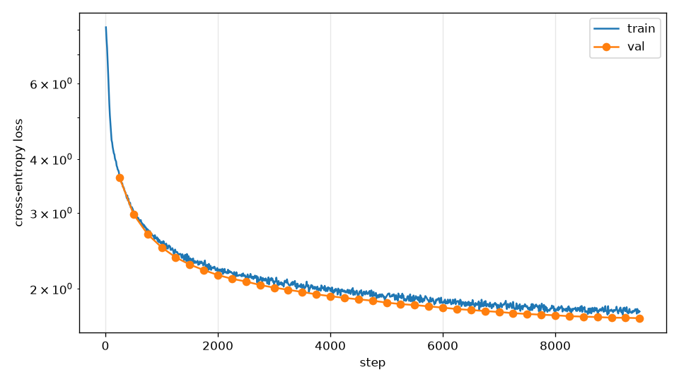

# Tiny GPT

**A GPT-style language model built from scratch in PyTorch, trained end to end on a laptop CPU, and shipped as a tested API, a Docker image and a published Hugging Face model.**

[](https://github.com/Ahmadbader17/tinygpt/actions/workflows/ci.yml)
· **Model:** [huggingface.co/Ahmadbader17/tiny-gpt](https://huggingface.co/Ahmadbader17/tiny-gpt)

**Tech stack:** Python · PyTorch · Transformer architecture · BPE tokenization · FastAPI · Pydantic · Docker · Hugging Face Hub · pytest · mypy · ruff · GitHub Actions · uv

---

## Aim
I wanted to understand how large language models actually work by building one myself, with no prebuilt model classes,
and to take it all the way from raw text to a deployed service, the way a real ML system is built.

## What I built
- **Transformer model from scratch:** causal multi-head self-attention, pre-norm blocks, MLP, weight tying (5.8M parameters).
- **Tokenizer and data pipeline:** byte-level BPE tokenizer (vocab 4,096) and memory-mapped training data.
- **Training loop:** AdamW, learning-rate warmup + cosine decay, gradient clipping, checkpoints with exact resume.
- **Inference:** text generation with temperature, top-k sampling and fixed seeds, available from a CLI.
- **Serving:** typed FastAPI service (`/v1/completions`) with input validation, a request queue and a demo web page.
- **Deployment:** non-root Docker image; model weights and a model card published on the Hugging Face Hub.
- **Engineering quality:** 120 automated tests, type checking, linting and CI on every push.

## Results
Trained on 77.8M tokens of the TinyStories dataset in **7.9 hours on a single laptop CPU (no GPU)**.

| Model | Validation perplexity (lower is better) |
|---|---|
| Bigram baseline | 38.4 |
| **Tiny GPT** | **5.4** |

Sample output (prompt in bold, not cherry-picked):

> **One day, a little girl named** Lucy went to play outside. She saw a big tree with a pretty flower. She thought it would be fun to draw with it.



Full numbers, more samples and failure cases are in [`docs/RESULTS.md`](docs/RESULTS.md).

## Key takeaways
- A small model trained on modest hardware can learn fluent, grammatical English when the data matches its size.
- **Measure, don't guess:** benchmarking showed 12 CPU threads trained 4–5× faster than all 22, which changed how the run was planned.
- Tests that check the maths (causality, attention equivalence, expected starting loss, exact resume) caught bugs early and made the long training run safe to trust.
- Building the full path, from data to a deployed API, taught as much as building the model itself.

## Try it
```bash
git clone https://github.com/Ahmadbader17/tinygpt && cd tinygpt && uv sync
uv run tinygpt generate --hub Ahmadbader17/tiny-gpt --prompt "Once upon a time, a little fox" --seed 42
```
Or run the API with Docker:
```bash
docker build -t tiny-gpt .
docker run -p 7860:7860 -e TINYGPT_HF_REPO=Ahmadbader17/tiny-gpt tiny-gpt
# open http://localhost:7860 (demo) or http://localhost:7860/docs (API)
```

## Limitations
- It writes simple children's stories; it is not a chat assistant and cannot follow instructions.
- Longer stories lose the plot or repeat themselves; the context window is 256 tokens.
- Not evaluated for bias or safety.

## More detail
- [`docs/architecture.md`](docs/architecture.md): how the pieces fit together
- [`DESIGN.md`](DESIGN.md) and [`docs/DECISIONS.md`](docs/DECISIONS.md): design and every decision made along the way
- [`docs/LEARNING.md`](docs/LEARNING.md): each stage explained with tensor shapes

## Licence and credits
Code and weights: MIT. Training data: [TinyStories](https://huggingface.co/datasets/roneneldan/TinyStories) by Ronen Eldan and Yuanzhi Li (CDLA-Sharing-1.0).
