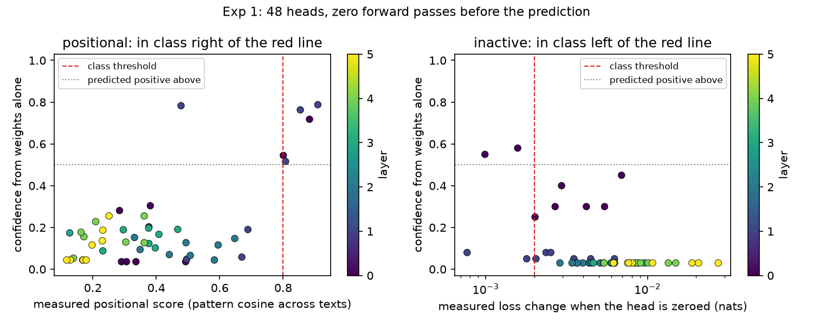
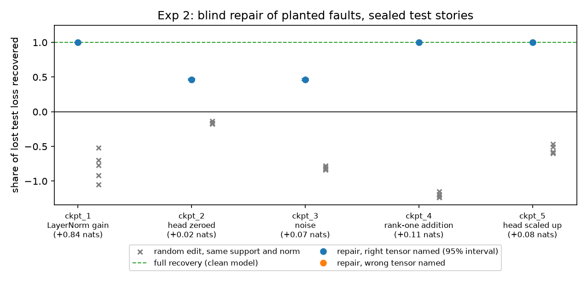
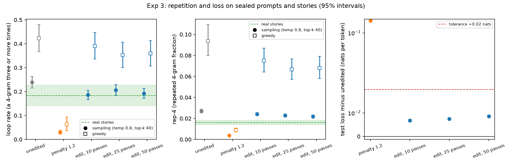
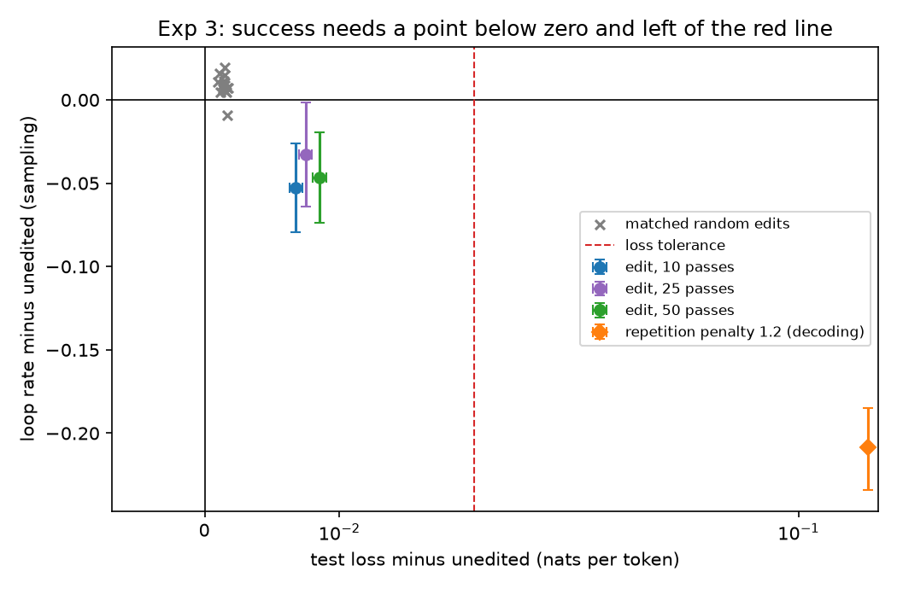

# Weight Space Programming on a 5.8M-parameter GPT: a small replication

Ahmad Bader, with Claude Fable 5.2 as editor and harness builder. 12 November 2026.
Branch `exp/weight_space_programming`, frozen at tag `wsp-freeze` (`de99f1b`).

## Abstract

"Sparks of Weight-Space Programming" (Takehi, Teoh, Zhang and Khattab, 2026) reports that a
general-purpose LLM can read a neural network's weights and write new ones directly, without an
optimizer. We test three versions of that claim on Tiny GPT, a 6-layer, 5.8M-parameter story
model, with hypotheses, thresholds and budgets fixed in advance and a test set that was not on
the machine until the edits were frozen. All three preregistered hypotheses were met.
(1) With no forward pass, the editor's predictions of what 48 attention heads do scored a
micro-F1 of 0.82 against a within-layer chance level of 0.29 (p = 0.0003), but four of the six
classes were empty and every correct positive lay in layers 0 and 1. (2) Five fresh editors,
each given one checkpoint with a planted fault and 20 forward passes, all named the damaged
tensor, and all five repairs beat matched random edits; three recovered the lost loss in full
and two, where the fault destroyed information, recovered 46% and 47%. (3) Three independent
editors with 10, 25 and 50 forward passes each scaled down a similar set of late attention
heads. On 300 sealed prompts the loop rate fell from 23.9% to between 18.6% and 20.6%, with
test loss rising by 0.007 to 0.009 nats against a tolerance of 0.02; two of the three edits
meet the success rule at the Bonferroni-corrected level. The effect is small, it does not grow
with the budget, and a decoding-time repetition penalty removes four times as much repetition,
though at a loss cost of 0.155 nats and well past the level of real stories. Our prior for (3)
was 15 to 20%, so we were wrong about it. The main caveats are the easy, outlier-shaped faults
of (2), the small effect of (3), and one checkpoint throughout.

## 1. Background and relation to the original work

In the original post an LLM agent ("GPT-6 Astra") is given a network's weights and, depending
on the experiment, a rationed number of forward passes. It reasons about what the parts
compute and writes weights by hand. The post has eight experiments. Three are the models for
ours:

| This study | Closest original | Same | Different |
|---|---|---|---|
| Exp 1: read 48 heads from weights only | Exp 3: find copying heads in three character-level transformers without running them; all found, no false positive | no forward passes; ground truth measured afterwards | six head classes; BPE model; explicit chance levels |
| Exp 2: blind repair of planted faults | none (nearest: Exp 4, fixing a stalled Kinetix policy) | diagnose and repair by writing weights | synthetic faults with known answers |
| Exp 3: reduce repetition | Exp 8: remove a "looping" direction from two MLPs of Qwen3.5-0.8B at 10, 25 and 50 forward passes | same three budgets; no gradients | 5.8M model; repetition metrics; sealed test, random-edit control and decoding baseline |

Two findings of the original matter for reading ours. Their Exp 8 worked on a model in which
93% of answers ran to the token limit; with 50 passes that fell to 33% and MATH-500 accuracy
rose from 7.9% to 48.1%, while with 10 or 25 passes "the loops barely went away". Their
follow-up on Gemma 3 270M, which rarely loops, found no gain, and they conclude: "Editing
weights could remove an obstacle that hid an ability, but it could not add an ability the model
lacked." Tiny GPT resembles the second model more than the first: its excess repetition over
real text is about 6 points of loop rate.

The numbers and the quotation above were checked against the post on 12 November 2026. The
plan's first description of their Exp 8 ("so that it stops looping") overstated it; this
section has the corrected figures. The post does not say whether its looping direction was
derived from activations or from weights.

## 2. Setup

**Model.** `Ahmadbader17/tiny-gpt` at Hub revision `36ee8ed`: 6 pre-norm blocks, 8 heads,
d_model 256, context 256, tied embeddings, 4,096-token byte-level BPE, trained on 300,000
TinyStories V2 stories. Validation loss 1.688 (reproduced: 1.6877).

**Data.** Dev data is the repository's validation split (the first 5,000 stories of the
official validation file). The sealed test is taken from later parts of the same file: stories
5,000 to 6,999 for loss (2,000 stories, 402,865 tokens) and the first 300 distinct 8-word
openings from story 7,000 on as prompts. The file was not on the machine during editing. It
was downloaded, hash-checked and read once by `final_eval.py` at the frozen commit, and once
more by the audit of section 5.3 (a different block of stories). Both reads are in
`experiments/wsp/logs/sealed_access.jsonl`. No sealed story duplicated a dev or train story.

**Metrics.** Loss is nats per token over whole stories. Generation uses the README settings
(temperature 0.8, top-k 40, at most 200 new tokens, 5 seeds per prompt) and greedy decoding.
*Loop rate* is the share of generations in which some 4-gram occurs three or more times;
*rep-4* is the share of 4-grams in a generation that repeat an earlier one. Intervals are
bootstrap intervals over stories or prompts (10,000 resamples), and every comparison between
two models is paired on the same stories, prompts and random numbers.

**Editors.** Claude Fable 5.2 throughout: the main session for Exp 1 and the harness, and one
fresh subagent per attempt for Exp 2 and Exp 3, each in its own workspace outside the
repository holding one checkpoint, the dev data, the rules and a sandbox.

## 3. Editor rules and how they were enforced

| Rule | Enforcement | What happened |
|---|---|---|
| No gradients or training | Autograd off in the sandbox; a static scan of every editor script | No hit |
| No fitting weights to data | Static scan for `lstsq`, `pinv`, solvers; an edit counts only if its script rebuilds it in a folder with no data | Three scan hits, all on weight matrices only (below) |
| No search over edits; at most 3 revisions | Every pass needs a written purpose logged before it runs; ledgers audited by hand | No sweep found; two judgement calls (below) |
| Forward passes rationed | One budgeted function with a hash-chained ledger | No refused call; every ledger verifies |
| No sealed data, no fault specs, no clean checkpoint in Exp 2 | Sealed data absent from disk; access-time tripwires on specs, clean copies and earlier editors' work; tool-call listing from each editor's transcript | Two tripwire alarms, both traced to git (below) |
| Original checkpoint untouched | Hash checked by every script | Unchanged |

We also held to a stricter reading than the original: a number written into a weight may
depend on existing weights and on scalars chosen by stated reasoning, never on activations
(interpretation I1 of the plan). Forward passes could be used to decide *which* component
matters, not to produce values. All eight final edits satisfy this: seven multiply existing
weights by a constant or remove a singular component, and one (Exp 2, `ckpt_2`) builds a
stand-in for a zeroed head from two neighbouring heads' weights.

Things a reader should know before trusting the table above:

- **Scan hits.** `ckpt_2`'s repair uses a pseudo-inverse of a weight matrix, and two analysis
  scripts (`ckpt_3`, Exp 3 `b10`) use `lstsq` or `pinv` on weights. The scan forbids these by
  name as a proxy for regression on data. We judged all three within the rules and list them
  in the rule test as audited cases. If `ckpt_2` is excluded instead, Exp 2 reads 4 of 4
  located and 4 of 4 repaired, and both hypotheses are still met.
- **Revisions that followed a measurement.** The `b10` editor moved its factor from 0.5 to
  0.75 after the first cost 0.0225 nats on 64 dev stories; it halved the step and did not
  solve for a value. The `b50` editor widened its head set from four to eight after a
  zero-ablation of the second four lowered dev repetition. Each is one declared revision with
  a written reason, but both used evaluation feedback, which is the direction rule 3 guards.
- **Tripwires.** Two alarms fired during Exp 2. Both were git re-reading tracked files whose
  timestamps the tripwire itself had changed; this was reproduced, fixed, and from then on no
  wire tripped. The transcripts show every editor's tool calls stayed inside its workspace.
- **Blinding rests partly on obedience.** The fault specs and the clean checkpoint were on the
  same disk as the Exp 2 editors. Tripwires and transcripts detect a read; they do not
  prevent one.
- **One interruption.** The `ckpt_2` editor was cut off by an account limit after finishing
  its work and was resumed to write its report. It spent no pass after resuming.

## 4. Experiment 1: reading heads from weights

With zero forward passes, the editor gave each of the 48 heads a confidence for six classes,
from the embedding, query-key and output-value matrices alone. The predictions were committed
(`1f61782`) before the verification script ran. Ground truth came from attention patterns on
256 dev windows and 64 repeated random sequences, and from zeroing each head on 500 dev
stories, with thresholds fixed before any weight was inspected.

| Class | Heads in class | Predicted | Hits | False alarms | Missed |
|---|---|---|---|---|---|
| previous token, start anchor, induction, duplicate token | 0 each | 0 each | | | |
| positional | 5 | 6 | 5 | 1 | 0 |
| mostly inactive | 4 | 2 | 2 | 0 | 2 |

Micro-precision 0.875, recall 0.78, F1 0.82. Shuffling predictions among heads of the same
layer gives a mean F1 of 0.29 and reaches 0.82 in 3 of 10,000 shuffles (p = 0.0003).
**H1 is met.**

How much this shows is limited:

- Four classes were empty, and "none" was predicted for each. Those calls were right, but
  they add nothing to the score.
- All seven hits are in layers 0 and 1. The editor's confidence ranks the positional score
  well there (Spearman 0.64) and not at all in layers 2 to 5 (0.16). Nothing behind an MLP
  was read, as the editor said before verification.
- Two hits cleared the threshold by less than 0.01. With stricter thresholds chosen after the
  fact, F1 falls to 0.67 and H1 still holds (p between 0.002 and 0.015).
- Two stated mechanisms were wrong although the labels came out right. The editor argued that
  no head could single out the previous position; six heads in layers 2 to 4 put 25 to 33% of
  their attention there, below the 0.40 line. And its direct-path estimate for start-anchor
  heads was negatively related to the measured score (Spearman -0.74).
- The "no induction heads" label depends on the probe. On repeated random tokens no head
  exceeded 0.03. On natural stories the Exp 3 editors later found late heads that attend to
  earlier occurrences and copy what followed (section 6). The class threshold measured a
  cleaner behaviour than this model has.

## 5. Experiment 2: blind repair of planted faults

A seeded injector built five damaged checkpoints, one per fault family, each calibrated on dev
data to cost between 0.02 and 1.0 nats. The specs were sealed. Five fresh editors each received
one checkpoint, the same task text naming no fault family, and 20 forward passes.

| Checkpoint | Planted fault | Damage (nats) | Tensor named | Recovery [95%] | Best of 5 random controls | Passes |
|---|---|---|---|---|---|---|
| ckpt_1 | 64 LayerNorm gains x 4.49 | +0.839 | right | 1.00 [1.00, 1.00] | -0.52 | 4 |
| ckpt_2 | head 5.6 zeroed | +0.020 | right, head right | 0.47 [0.45, 0.48] | -0.13 | 4 |
| ckpt_3 | Gaussian noise on one attention output matrix | +0.074 | right | 0.46 [0.45, 0.47] | -0.78 | 8 |
| ckpt_4 | rank-one term added to one MLP output matrix | +0.112 | right | 1.00 [1.00, 1.00] | -1.15 | 4 |
| ckpt_5 | head 5.5 output x 5.72 | +0.082 | right, head right | 1.00 [1.00, 1.00] | -0.47 | 5 |

Recovery is the share of the lost sealed-test loss won back. Random controls change the same
entries by the same norm; every one of them made the model worse.

**H2a is met** (5 of 5 tensors named; needed 3). **H2b is met** (5 of 5 repairs have an
interval above zero and beat all controls; needed 3). Mean recovery is 0.79.

### 5.1 How the faults were found

Every diagnosis came from weight statistics before any forward pass: a cluster of gains four
times larger than the rest; 32 columns exactly zero; an output matrix whose norm did not match
its head's value matrix; one singular value twelve times the next; one head's output norm 5.7
times its peers'. The passes were then used to confirm (4 to 8 of 20). The repairs for the
three invertible faults estimate the fault's size from the weights: 4.5 against a true 4.49;
5.556 against 5.72; the top singular component against the planted rank-one term (cosine
0.999 with the true inverse).

### 5.2 What this does and does not show

The faults were built to be measurable, and that made them conspicuous: each is an outlier
against the other layers in a simple statistic. A fault the size of normal variation between
layers would be a different problem, and this experiment says nothing about it. The two
faults that destroyed information were only half repaired, as expected: the zeroed head got a
stand-in averaged from two similar heads, and the noisy matrix was shrunk towards the subspace
its value matrix implies. Neither recovers the original weights (cosine 0.54 and 0.84).

The weakest case is `ckpt_2`. Its damage is 0.020 nats, the smallest the plan allowed, so "47%
recovered" is 0.009 nats. It is also the repair that uses the pseudo-inverse discussed in
section 3.

### 5.3 Audit of a result that looked too good

The plan requires an audit of any recovery above 100%. `ckpt_5` scored 1.0003
[1.0002, 1.0004]: the repaired model was better than the clean one by 0.00002 nats. We checked
for a leak (tripwires clean, transcript clean, the repair script rebuilds from the damaged
checkpoint alone) and repeated the measurement on a block of 2,000 sealed stories that nothing
else had read (`audit_ckpt5.py`). The result repeated: repaired minus clean is -0.000019 nats
[-0.000029, -0.000009]. The explanation is in the numbers: the editor divided by 5.556 where
the fault multiplied by 5.72, which leaves that head 3% stronger than trained, and that
happens to be very slightly better on this data. It is a real effect of one part in 100,000
of the loss, and we report the recovery as 100%.

## 6. Experiment 3: reducing repetition (headline)

The README lists as a limitation that the model "repeats itself". Three fresh editors, with
budgets of 10, 25 and 50 forward passes, were asked to find what drives the repetition and to
write an edit that reduces it without costing more than 0.02 nats of test loss or more than
10% of story length. They did not see each other's work: the workspaces never existed at the
same time, and none of the tripwires on earlier attempts' files fired.

### 6.1 What the editors did

| Attempt | Passes used | Heads whose output was scaled | Factor | Weights changed |
|---|---|---|---|---|
| b10 | 10 of 10 | 4.4, 4.5, 5.6, 5.7 | 0.75 | 32,768 (0.56%) |
| b25 | 22 of 25 | 3.0, 4.5, 4.6, 5.1, 5.4, 5.6, 5.7 | 0.8 | 57,344 (0.98%) |
| b50 | 40 of 50 | 3.0, 4.4, 4.5, 4.6, 5.1, 5.4, 5.6, 5.7 | 0.8 | 65,536 (1.1%) |

All three reached the same account independently. The loops under sampling are not stutters
but re-mentions: names, noun phrases and dialogue frames from earlier in the same story. A
group of heads in layers 3 to 5 attends to earlier occurrences and raises the logit of the
token that followed. The editors do not call this a fault: on real stories the model repeats
about as often as the text does. Their argument is that decoding at temperature 0.8 sharpens
every preference, including "say it again", and that the model then conditions on its own more
repetitive text. Two editors chose the factor 0.8 for that reason, to cancel the sharpening for
these heads only.

### 6.2 Results on sealed data

Sampling decoder, 300 sealed prompts x 5 seeds; loss on 2,000 sealed stories.

| Model | Loop rate | rep-4 | Mean length | Test loss |
|---|---|---|---|---|
| Real stories, same prompts | 0.183 [0.140, 0.227] | 0.0162 | 168.9 | |
| Unedited | 0.239 [0.215, 0.263] | 0.0270 | 160.9 | 1.6125 |
| Edit, 10 passes | 0.186 | 0.0240 | 161.5 | 1.6193 |
| Edit, 25 passes | 0.206 | 0.0229 | 161.3 | 1.6200 |
| Edit, 50 passes | 0.192 | 0.0219 | 161.3 | 1.6210 |
| Unedited + repetition penalty 1.2 | 0.030 | 0.0037 | 150.0 | 1.7678 |

Paired differences from the unedited model, 95% intervals:

| Model | Loop rate | rep-4 | Test loss | Length ratio | Rule met at 95% | At 98.3% |
|---|---|---|---|---|---|---|
| Edit, 10 passes | -0.053 [-0.079, -0.026] | -0.0029 [-0.0046, -0.0012] | +0.0068 [+0.0063, +0.0072] | 1.004 | yes | yes |
| Edit, 25 passes | -0.033 [-0.064, -0.001] | -0.0041 [-0.0058, -0.0024] | +0.0075 [+0.0070, +0.0080] | 1.003 | yes | no |
| Edit, 50 passes | -0.047 [-0.074, -0.019] | -0.0051 [-0.0067, -0.0034] | +0.0085 [+0.0081, +0.0090] | 1.003 | yes | yes |
| Repetition penalty 1.2 | -0.209 [-0.234, -0.185] | -0.0232 [-0.0250, -0.0215] | +0.1553 [+0.1531, +0.1574] | 0.932 | no (loss) | no |

**H3 is met.** Each attempt meets all four criteria at 95%. The headline claim required at
least one to do so with 98.3% intervals (Bonferroni over three attempts); the 10-pass and
50-pass edits do, the 25-pass edit does not (its loop-rate interval no longer excludes zero).

- **Specific, not generic damage.** Fifteen random edits of the same entries and the same
  norm (five per attempt) changed loop rate by between -0.009 and +0.019 and raised loss by
  0.001 to 0.002 nats. Every edit beats all five of its controls.
- **The text stays in distribution.** The unedited model scores the edited models' stories at
  1.042 to 1.049 nats per token against 1.039 for its own, so the edits do not buy less
  repetition with odd text. The penalised decoder's stories score 1.392.
- **Greedy decoding** is secondary by the plan. rep-4 falls for all three edits (by 0.019 to
  0.027 from 0.094). Loop rate falls by 0.03 to 0.07 from 0.423, with an interval excluding
  zero only for the 25-pass edit.
- **The test loss rose for every edit**, with intervals well above zero. No edit improved the
  model as a predictor of stories, and none was expected to.

The first sampled story for each of the first five sealed prompts, for every model, is in
`experiments/wsp/results/tables.md`; the first story for all 300 prompts is in
`final_generations.json`. None was selected.

### 6.3 Reading the result

**The effect is real and small.** About five points of loop rate and a tenth to a fifth of
rep-4. A reader comparing two stories would not see it. After the edits the loop rate equals
that of real stories (0.186 to 0.206 against 0.183), while rep-4 is still above it (0.022 to
0.024 against 0.016).

**The edit is a trade, not a repair.** It costs 0.007 to 0.009 nats, about a third of the
tolerance, because the heads it weakens are the ones that keep a story's names and objects
consistent. This agrees with the original authors' distinction: nothing was hidden here that
an edit could uncover.

**More passes did not help.** The 10-pass edit did as well as the 50-pass one. In the original
the gain appeared only at 50. Here the budget was not the binding constraint. The reasoning
was.

**The conventional fix is stronger and blunter.** The repetition penalty removes four times
as much repetition. It also pushes the loop rate to 0.030, a sixth of the level of real
stories, shortens stories by 7% and fails the loss criterion by a wide margin: as a predictor
of real text the penalised decoder is 0.155 nats worse. Which is preferable depends on whether
one wants text that repeats as little as possible or as much as real stories do.

**A comparison we did not run.** If the excess comes from temperature 0.8, then sampling at
temperature 1.0 is the obvious alternative, and the 10-pass editor measured it on dev prompts
(loop rate 0.172). It was not preregistered and was not evaluated on sealed data, so the
report cannot say whether the edits do anything that a temperature change would not.

## 7. Discussion

Our stated prior for H3 was 15 to 20%, for H2b 35%. Both were met. The prior for H3 was wrong
in a specific way: we expected that anything strong enough to move repetition would break the
loss tolerance. The editors found that a 20 to 25% reduction of a few heads' output is enough
to move loop rate measurably at a third of the tolerance.

What the three experiments have in common is that the weights were read successfully where a
simple statistic or a single linear path exposed the answer (norms, spectra, one head's
output-value circuit), and less so where the answer sat behind nonlinear layers. In Exp 1 that
boundary was layer 1. In Exp 3 the heads were chosen partly from weights and confirmed with
activations, and the 10-pass editor reports that weights alone found only two of its four.

### Evidence behind each mechanistic claim

| Claim | Evidence | Status |
|---|---|---|
| Layers 0 and 1 hold diffuse, position-driven heads with small writes | Weights (before) and measured attention (after) agree | Supported |
| Explanations of heads in layers 2 to 5 from weights | Confidence unrelated to measurement | Not supported |
| The Exp 2 faults are where the editors said | Sealed specs | Verified |
| Late heads 4.5, 5.6, 5.7 and others drive repetition | Scaling them lowers repetition on sealed prompts; matched random edits do not; three editors converged independently | Supported causally, for the group |
| These heads copy by an induction-like mechanism | Editors' own weight analysis and dev captures only; not re-measured by the harness; Exp 1's probe on random repeats found no induction head | Plausible, not verified |
| Excess repetition is caused by temperature 0.8, and 0.8 is the right factor | Editors' argument plus one dev measurement at temperature 1.0; no sealed test; no other factor tried | A story that fits, not a result |
| Contribution of each individual head | Never tested one head at a time | Unknown |

## 8. Limitations and threats to validity

- **One checkpoint, one training seed.** Every result concerns a single set of weights.
  Another seed could place the copying behaviour in different heads or spread it more thinly.
- **A different editor from the original.** The original used GPT-6 Astra; we used Claude
  Fable 5.2. Agreement or disagreement with their results mixes the method with the editor.
- **Blinding in Exp 2 relies on the editor obeying instructions**, as section 3 describes.
- **Small model, one dataset.** A 5.8M-parameter model trained on templated children's
  stories has few components and simple behaviour. Nothing here says how this scales.
- **The editor's reasoning may be a post hoc story.** The table in section 7 grades each
  claim. The edits work on sealed data; the explanations of why are less well tested than the
  edits themselves.
- **Half the planned prompts.** The plan says 600 sealed prompts; the protocol constant in the
  code said 300 from the first commit, and the evaluation ran with 300. This was noticed only
  afterwards. It widens the intervals by about 1.4 times and does not bias them. The
  evaluation was not rerun, since the plan allows one run.
- **Exp 1's score rests on two classes** and partly on two borderline hits.
- **Exp 2's faults are outliers by construction**, and one family each. Five cases cannot
  estimate a success rate.
- **Exp 3's three attempts are not three independent samples of the method.** They share a
  model, a prompt, and an editor model, and they converged on one idea. They show that the
  idea is reproducible, not that three different ideas work.
- **Loop rate has a floor in real text.** 18% of real continuations trip it, so it measures
  phrase reuse as much as pathology. Long loops (an 8-gram three times) are rare under
  sampling for every model and unchanged by the edits.
- **Rule 3 was kept in letter; two revisions used feedback** (section 3).
- **The harness builder and the Exp 1 editor are the same session**, and the harness builder
  audited the editors' ledgers. No second party checked those audits.

## 9. Reproducing this

Environment of the reported run: Intel Core Ultra 9 185H (22 logical cores, 12 threads used),
15 GB RAM, no GPU, WSL2 Linux 6.18; Python 3.12.3, torch 2.14.1+cpu, numpy 2.5.4,
tokenizers 0.23.3, safetensors 0.8.0, matplotlib 3.11.2. Final evaluation: 62 minutes.

The commands are in the README section "Weight Space Programming study". Every edited
checkpoint is rebuilt from the published weights by a script, and its sha256 is pinned in
`experiments/wsp/manifest.json`. The journals, ledgers, editors' scripts and their own
diagnoses are in `experiments/wsp/logs/` and `experiments/wsp/edits/`, released as they were
written.
