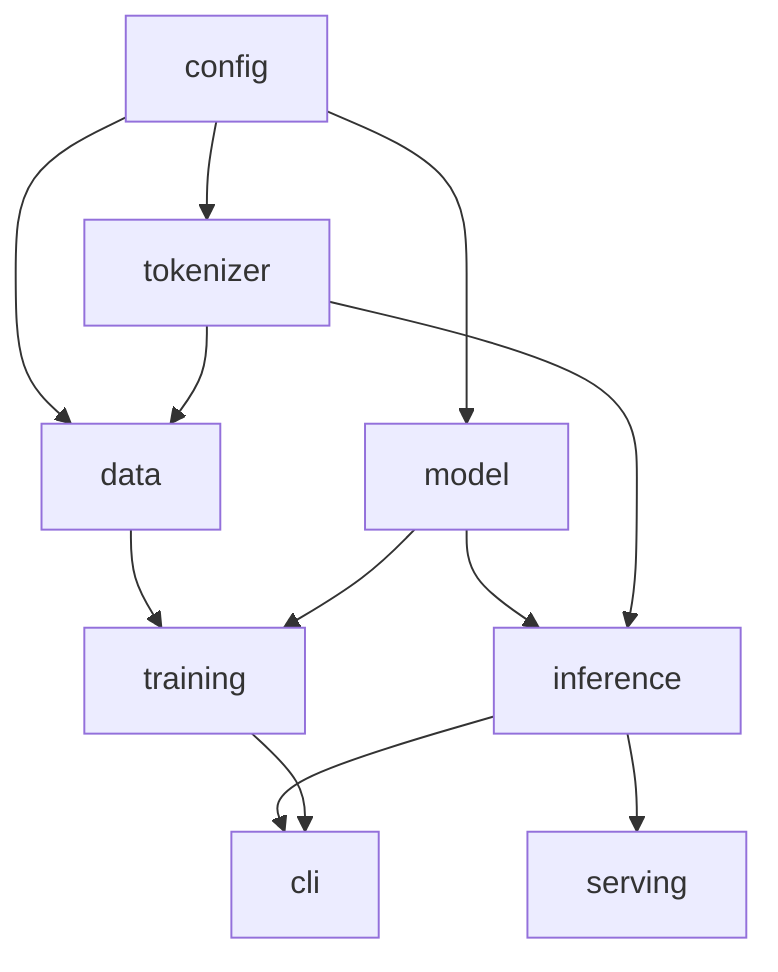
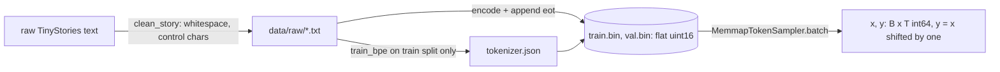
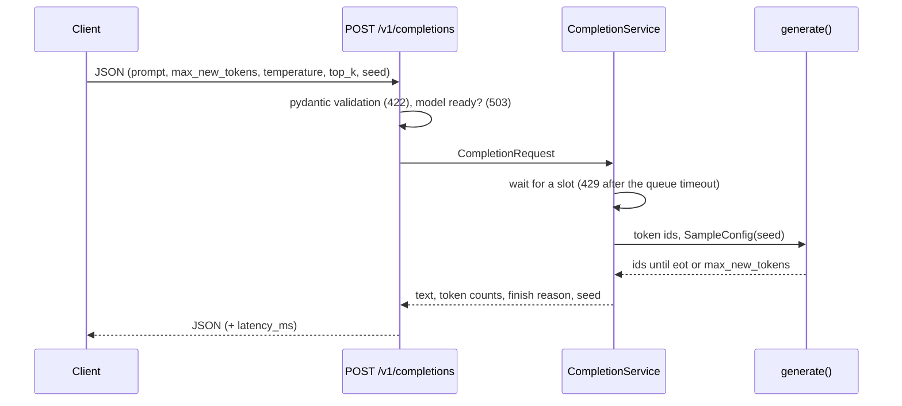

# Architecture

## Module dependencies
Arrows point from a dependency to the code that uses it. Nothing imports in the reverse direction, and only `serving` imports FastAPI.


The CLI and the API both call the same `CompletionService`, so a completion from `tinygpt generate` and from `POST /v1/completions` use identical code (and the same seed gives the same text).

## Data flow

`meta.json` stores token counts and the tokenizer's SHA256. The memmap costs about 2 bytes per token on disk and almost no RAM.

## One forward pass (small config: B batch, T = 256, C = 256, H = 8, V = 4096)
```text
idx (B, T) -> wte + wpe -> (B, T, C)
  6 x Block:  x = x + attn(ln1(x));  x = x + mlp(ln2(x))
     attn: qkv (B, T, 3C) -> heads (B, H, T, 32) -> softmax(QK^T / sqrt(32), causal mask) V -> (B, T, C)
     mlp:  C -> 4C -> C with GELU
ln_f -> lm_head (tied to wte) -> logits (B, T, V);  loss = cross_entropy over B*T positions
```

## One training step
`lr_at(step)` -> `x, y = sampler.batch` -> `loss = model(x, y)` -> `(loss / grad_accum).backward()` -> `clip_grad_norm_(1.0)` -> `AdamW.step()`.
Every 250 steps: validation on the same fixed windows, `best` and `last` checkpoints (atomic write), and 5 fixed-prompt samples to `samples.md`.
A checkpoint holds the weights (safetensors), the optimiser state, the step, and both RNG states, which is why resume is exact.

## One request

The route is a plain `def`, so FastAPI runs it in a worker thread and the event loop keeps serving `/health` during generation.

## Files and formats
| Artefact | Where | Format |
|---|---|---|
| Training tokens | `data/processed/{train,val}.bin` | flat `uint16`, one `<|endoftext|>` per story |
| Tokenizer | `data/tokenizer/tokenizer.json` | HF `tokenizers` JSON (byte-level BPE) |
| Run | `runs/<name>/` | `config.toml`, `environment.json`, `git_commit.txt`, `metrics.csv`, `loss.png`, `samples.md`, `train.log`, `checkpoints/{best,last}` |
| Checkpoint | `checkpoints/<name>/` | `model.safetensors`, `model_config.json`, `trainer_state.pt` (loaded with `weights_only=True`), `state.json` |
| Serving bundle | `export/` and the Hub repo | `model.safetensors`, `model_config.json`, `tokenizer.json`, `model_info.json` |

## Where the key decisions are recorded
Tokenizer size, architecture, optimiser and budgets are in `DESIGN.md`. Changes and measurements that overrode or extended it are in `docs/DECISIONS.md`
(for example 0006: thread count and token budget from the benchmark; 0007: the export bundle; 0008: publishing layout and what was not verified).
